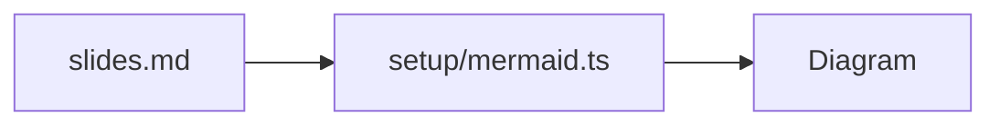

# Every setup hook

Twelve files in `setup/`, and what each one changes

<div class="hook-status mt-8"><span class="s-main">main.ts</span><span class="s-providers">providers.ts</span><span class="s-root">root.ts</span></div>

<!--
The dots light up when the three start-up hooks have run. root.ts also puts the current address in the top right corner;
press Shift+K to hide it.
-->

---

# shiki.ts

Elixir added as a language, GitHub colours, and a transformer that marks each block and dims its first line.

```elixir
# greeter.ex
defmodule Greeter do
  def hello(name), do: "Hello, #{name}!"
end
```

```ts
// answer.ts
const answer: number = 42;
console.log(answer);
```

<!-- The teal edge and the italic first line both come from the transformer in setup/shiki.ts. -->

---

# katex.ts

Two macros, `\RR` and `\deriv`, defined once for the whole deck:

$$
\deriv{y}{x} = 2x, \qquad f: \RR \to \RR
$$

Inline too: the slope of $y = x^2$ is $\deriv{y}{x}$ for every $x \in \RR$.

---

# transformers.ts

A markdown transformer turns triple brackets into a [[[highlight]]], before the markdown is parsed.

A code block transformer replaces `stats` blocks with a summary of their text:

```stats
Setup hooks are small files next to slides.md.
Each one changes one part of the deck.
```

---

!! preparser.ts

This title was written as `!! preparser.ts`; the preparser turned it into a heading in capitals.

Written by @@author: the name is a placeholder, filled in from `author:` in the headmatter.

<!-- The preparser also runs on the notes: this note was signed by @@author. -->

---

# mermaid.ts

The base theme with the deck's teal:



---

# monaco.ts

An editor theme with teal keywords and an 18 px font, so the back row can read it:

```ts {monaco}
const greeting: string = 'hello from monaco';
console.log(greeting.toUpperCase());
```

---

# code-runners.ts

A runner for a small `units` language, registered with Monaco in `setup/monaco.ts`. Edit the lines and run again:

```units {monaco-run} {autorun:true}
42 km
70 kg
21 c
```

---

# code-runners.ts: CSV

A second runner reads a small table and adds up the columns that hold numbers:

```csv {monaco-run} {autorun:true}
city, talks, attendees
Lisbon, 4, 310
Utrecht, 3, 240
Tallinn, 5, 395
```

---

# shortcuts.ts and context-menu.ts

<div class="grid grid-cols-2 gap-8 mt-4">
<div>

### Keys

| Key | Action |
| --- | --- |
| <kbd>x</kbd> | dark mode |
| <kbd>n</kbd> | next step |
| <kbd>Shift</kbd> + <kbd>K</kbd> | address label |
| <kbd>f</kbd> | removed |

</div>
<div>

### Right-click menu

A new first entry, **Copy link to this slide**, above the built-in ones.

Hold <kbd>Shift</kbd> while right clicking for the browser's own menu.

</div>
</div>

---
layout: end
---

# Done
