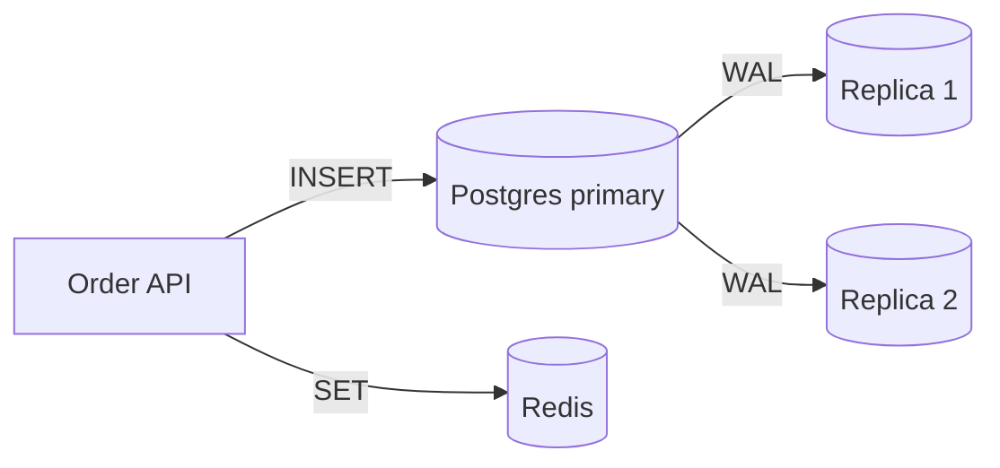

# Data layer

---
level: 2
---

# Storage choices

| Store      | Used for          | Owner team |
| ---------- | ----------------- | ---------- |
| PostgreSQL | orders, customers | Core       |
| Redis      | sessions, cache   | Platform   |
| S3         | invoices (PDF)    | Billing    |

<bp-note label="B">Postgres is a single primary today — see risk R2.</bp-note>

---
level: 2
---

# Write path

<!-- Both replicas are read-only and in the same zone as the primary. A zone outage takes all three. -->
