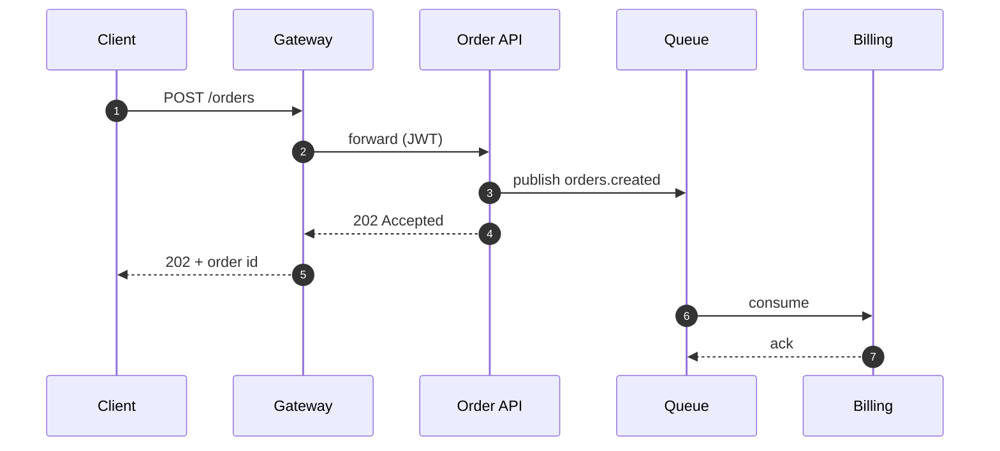
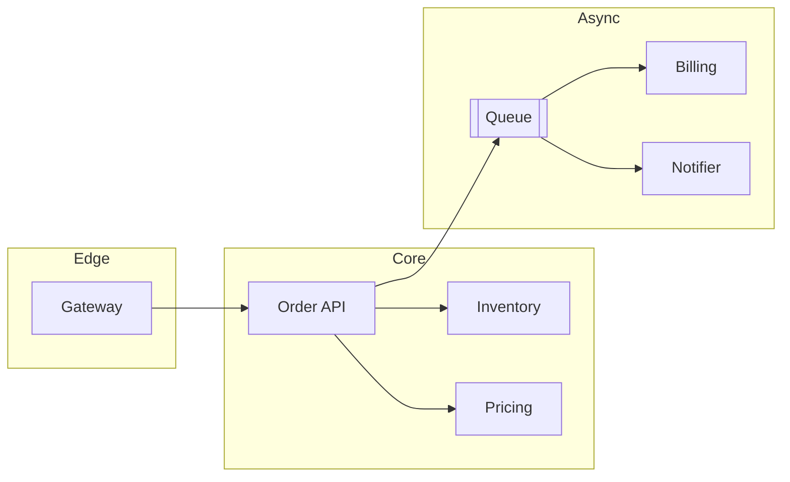

# Order Platform Architecture Review

Q4 2026 · Platform Guild

<!-- Goal: agree on the three risks and their owners by the end of the hour. -->

---
hideInToc: true
---

# Agenda

<slide-ng-toc columns="2" />

<bp-note label="A">All diagrams reflect production as of 2026-10-01.</bp-note>

---
layout: section
level: 1
---

# Current topology

---
level: 2
---

# Request flow



<!-- The client gets its answer at step 5; billing happens later, from the queue. -->

---
level: 2
---

# Service map



<!-- Three zones, three teams: Edge is Platform, Core is Core, Async is Billing and Notifications. -->

---
layout: section
level: 1
---

# Code walk-through

---
level: 2
---

# The order handler

```ts {12-13|14-15|all} {lines:true, startLine:10}
export async function handleOrder(order: Order) {
  if (order.total <= 0) throw new Error('empty order');
  const priced = await pricing.quote(order);
  await inventory.reserve(priced.items);
  await queue.publish('orders.created', priced);
  await db.insert('orders', priced);
  return { accepted: true, id: order.id };
}
```

<bp-note label="C">Lines 14–15: the event goes out before the order is stored. If the insert fails, Billing charges an order that does not exist.</bp-note>

<!--
[click] Pricing and inventory are synchronous calls; both have timeouts, see the limits later.
[click] This is the dual write: two systems, no shared transaction.
[click] Everything else in the handler is fine.
-->

---
level: 2
---

# Straight from the repo

The handler region of `order-service/handler.ts`, then the whole file:

<<< ./snippets/example.ts#handler ts {2|3}

<<< ./snippets/example.ts {*}{lines:true, maxHeight:'140px'}

<!-- These blocks are read from the file at build time, so the slide cannot drift from the code. -->

---
level: 2
---

# Config per environment

::code-group

```yaml [prod.yaml]
replicas: 6
queue:
  url: amqp://mq.prod.internal
  prefetch: 50
```

```yaml [staging.yaml]
replicas: 2
queue:
  url: amqp://mq.staging.internal
  prefetch: 10
```

```json [local.json]
{ "replicas": 1, "queue": { "url": "amqp://localhost", "prefetch": 1 } }
```

::

<!-- Prefetch 50 in production is why Billing gets flooded after an outage: see R3. -->

---
level: 2
---

# Proposed refactor (outbox)

````md magic-move {lines: true}
```ts
async function handleOrder(order: Order) {
  await db.insert('orders', order);
  await queue.publish('orders.created', order);
}
```

```ts
async function handleOrder(order: Order) {
  await db.transaction(async (tx) => {
    await tx.insert('orders', order);
    await tx.insert('outbox', { topic: 'orders.created', body: order });
  });
}
```

```ts {*|6-8}
async function handleOrder(order: Order) {
  await db.transaction(async (tx) => {
    await tx.insert('orders', order);
    await tx.insert('outbox', { topic: 'orders.created', body: order });
  });
}
// relay: polls the outbox and publishes
setInterval(relayOutbox, 500);
```
````

<!--
Step one: the two writes as they are today.
[click] Both rows go into Postgres in one transaction: either both exist or neither does.
[click] A relay publishes what is in the outbox.
[click] At-least-once delivery: consumers must be idempotent, which Billing already is.
-->

---
level: 2
---

# Types and limits

```ts twoslash
interface Order { id: string; total: number; items: string[] }
const sample: Order = { id: 'o-1', total: 42, items: ['sku-1'] };
const count = sample.items.length;
//    ^?
```

Current limits (the block scrolls):

```ts {*}{maxHeight:'120px'}
export const limits = {
  ordersPerMinute: 600,
  maxItems: 200,
  maxTotal: 50_000,
  retry: { attempts: 5, backoffMs: 250 },
  timeouts: { pricing: 800, inventory: 1200, queue: 300 },
  featureFlags: { outbox: false, sagas: false },
};
```

<!-- Hover the code to see the types. The outbox flag is already there, switched off. -->

---
src: ./pages/data-layer.md
---

---
level: 1
---

# Risks and decisions

| ID | Risk                              | Decision              | Owner    |
| -- | --------------------------------- | --------------------- | -------- |
| R1 | Dual write order + queue          | Adopt outbox (Q1)     | Core     |
| R2 | Single Postgres primary           | Evaluate Patroni      | Platform |
| R3 | No back-pressure on Billing       | Add prefetch limits   | Billing  |

<div slide-ng-click><bp-note label="D">Review again in Q2 2027.</bp-note></div>

<!-- Ask each owner to confirm out loud. [click] Then book the follow-up. -->

---
layout: center
class: text-center
hideInToc: true
---

# End of sheet

Questions and objections to the Platform Guild channel.
