# The Diagram Zoo

Every Mermaid animal, fed and photographed

<!--
Every diagram here is a Mermaid code block, drawn in the browser. The deck follows the system colour mode: press `d` to switch and watch the diagrams follow.
-->

---

# Flowcharts: left to right, top down

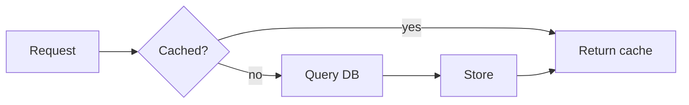

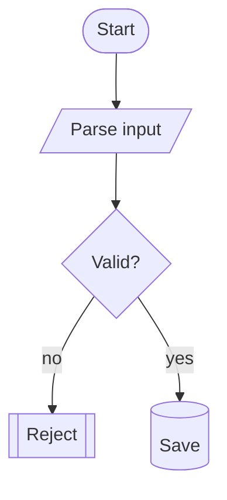

<!--
Options after `mermaid` pick the theme and the scale: the right-hand chart uses the neutral theme and is drawn at 60 %. Any other key goes to Mermaid's own initialize.
`setup/mermaid.ts` sets the font and the curved edges for every diagram in the deck.
-->

---

# A long pipeline, in three lanes

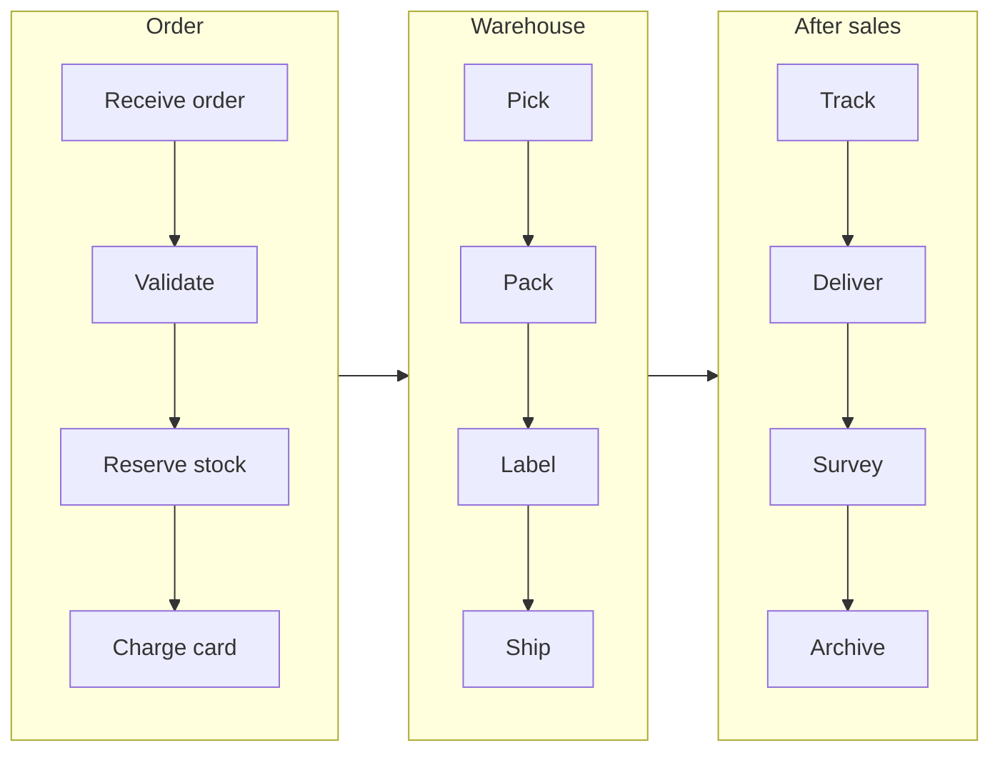

<!--
Twelve steps would never fit in one column; subgraphs with their own direction fold them into lanes, and the arrows link the lanes.
-->

---

# Sequence with autonumber

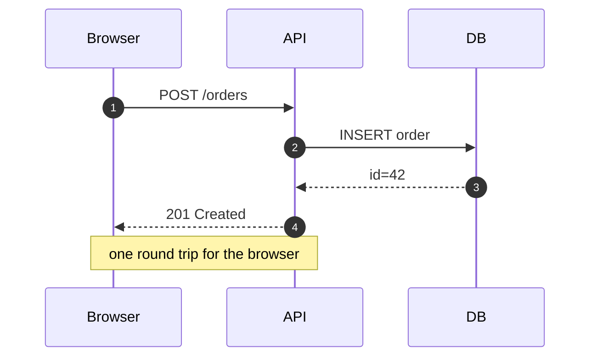

---

# Class and state

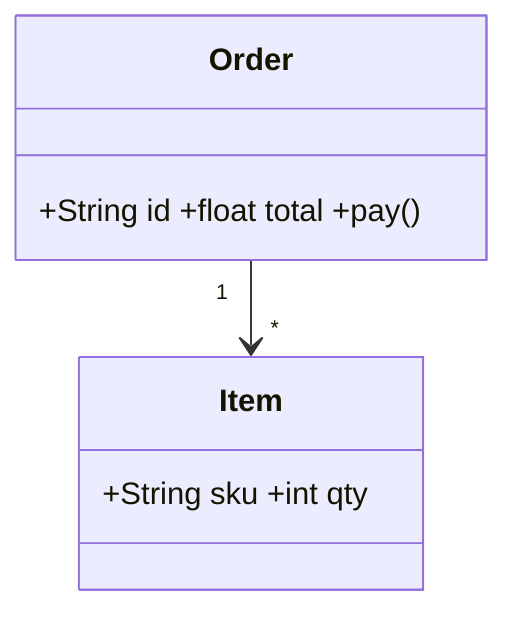

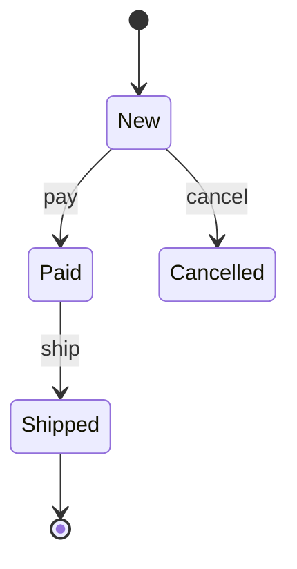

---

# Entity relations

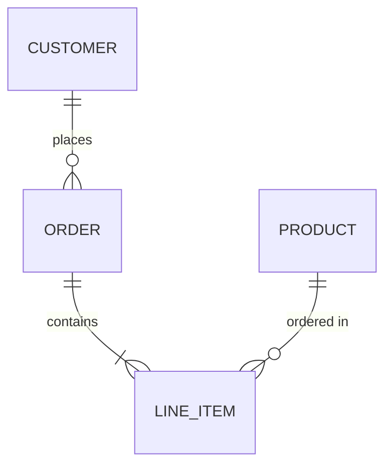

---

# A release plan

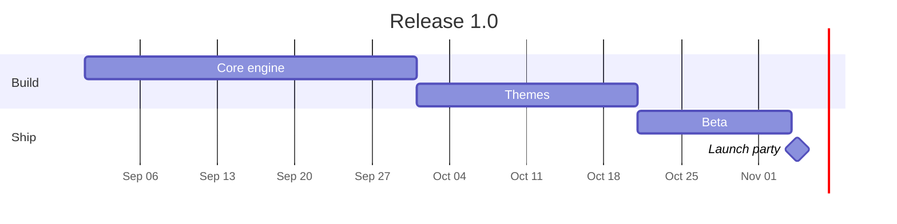

---

# Pie, mindmap, timeline

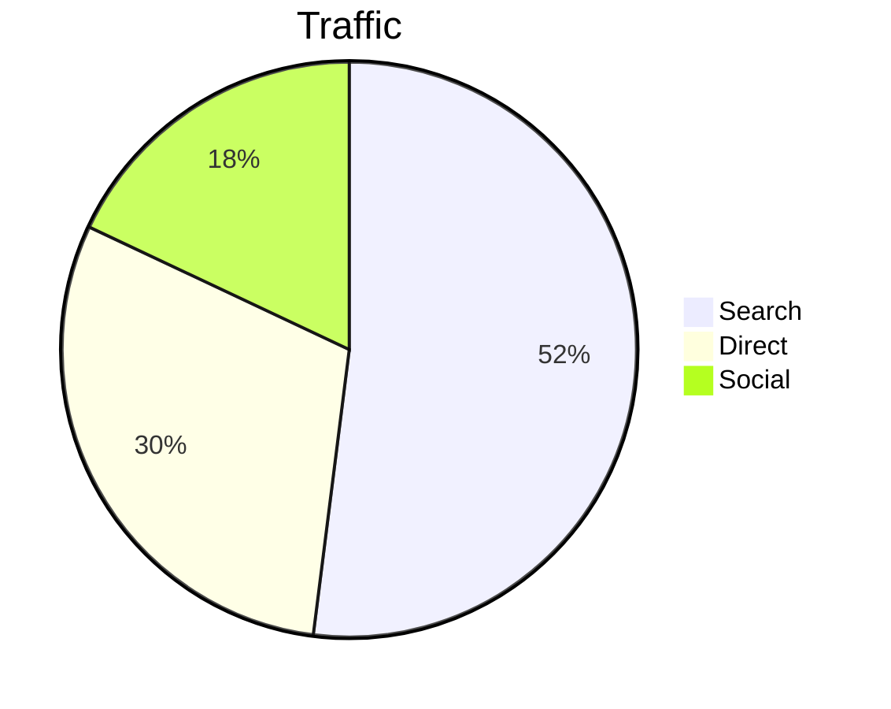

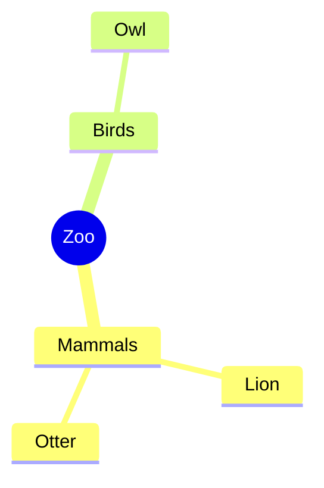

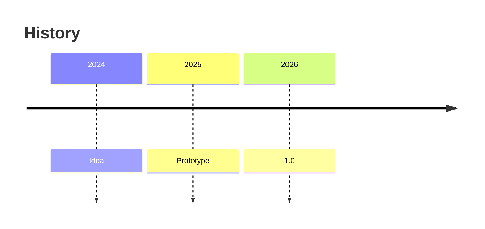

---

# gitGraph, journey, quadrant

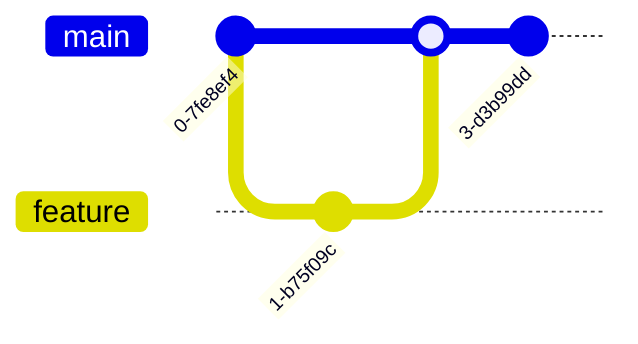

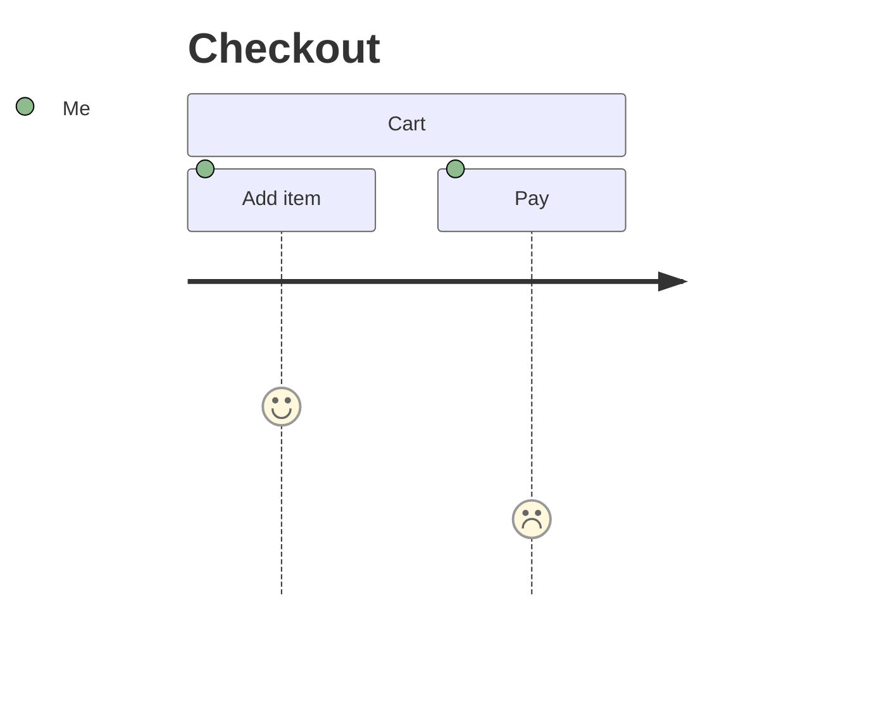

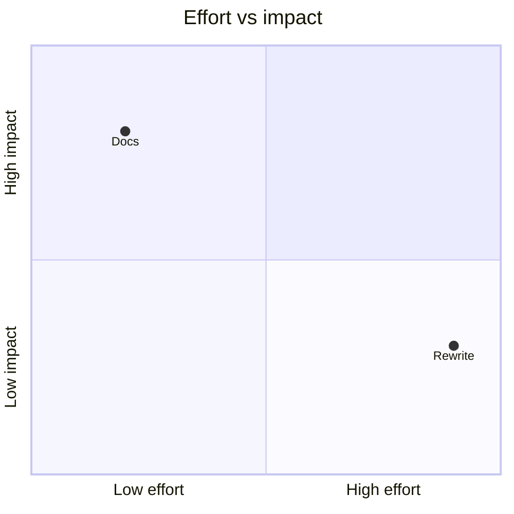

---

# As a tag, and PlantUML

<slide-ng-mermaid code="graph LR; X[A tag] --> Y[A diagram]" />

`<slide-ng-mermaid code="..." />` draws a diagram from an attribute, handy inside your own components.

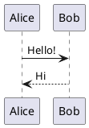

PlantUML diagrams are pictures from a PlantUML server, so they need the network.

---
class: bg-gray-900 text-white
---

# Night shift

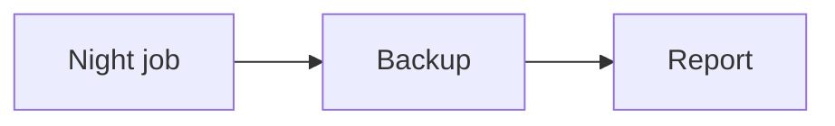

This slide is dark in both colour modes (class: bg-gray-900 text-white), so its diagram asks for theme:'dark' instead of following the mode.

---

# Light and dark

<slide-ng-light-or-dark>
  
You are in dark mode: every diagram without its own theme is drawn with Mermaid's <code>dark</code> theme.

  
You are in light mode: every diagram without its own theme is drawn with Mermaid's <code>default</code> theme.

</slide-ng-light-or-dark>

Press <code>d</code> and go back through the zoo.

