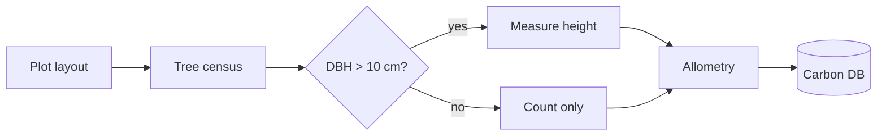
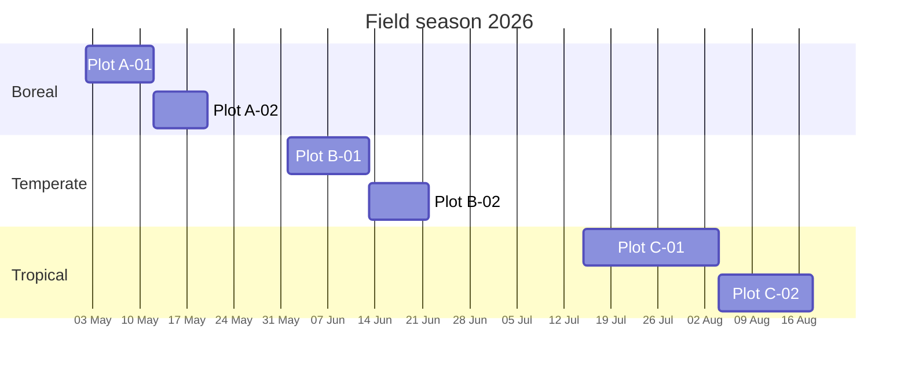
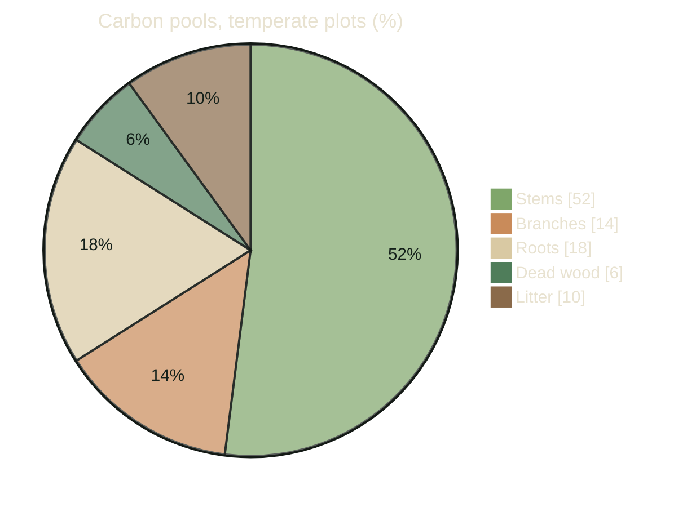

# Forest Carbon Field Report

Season 2026 · six plots, three biomes

<!-- Opening: thank the field crews, and the two landowners who gave us access. -->

---
hideInToc: true
---

# Contents

<slide-ng-toc columns="3" />

---
layout: section
level: 1
---

# Methods

---
level: 2
---

# How we measure carbon

Above-ground biomass from allometry: $AGB = \rho \cdot e^{-1.803 - 0.976E + 0.976\ln\rho + 2.673\ln D - 0.0299(\ln D)^2}$

$$ {1|2|3|all}
\begin{aligned}
C &= AGB \times CF \\
CF &\approx 0.47 \\
CO_2e &= C \times \tfrac{44}{12}
\end{aligned}
$$

Where $D$ is the stem diameter at breast height (cm), $\rho$ the wood density and $E$ a measure of environmental stress.
A plot with 300 t of biomass per hectare holds {{ 300 | carbon }} t of carbon, or {{ 300 | carbon: 'co2' }} t of CO₂.

<!--
The first line is the pantropical equation; we use the boreal and temperate variants for those plots.
[click] Carbon is about half of dry wood.
[click] The carbon fraction is the IPCC default.
[click] Multiply by 44/12 to go from carbon to CO2.
-->

---
level: 2
---

# Survey workflow

<!-- Every stem over 10 cm gets a tag, a diameter and a height; smaller stems are counted by size class. -->

---
level: 2
---

# Field season

<!-- Tropical plots took longest: more stems, and the wet season ran late. -->

---
layout: section
level: 1
transition: fade
---

# Findings

---
layout: two-cols-header
level: 2
---

# Carbon stocks by biome

::left::

<moss-stat value="58 t" label="C/ha, boreal mean"></moss-stat>

- Slow growth, deep soils
- Most carbon is **below ground**

::right::

<moss-stat value="166 t" label="C/ha, tropical mean"></moss-stat>

- Fast cycling
- Most carbon is **in the trees**

::bottom::

Means over two plots per biome; soil carbon not included.

---
level: 2
---

# Where the carbon sits

<!-- Roots are estimated from root-to-shoot ratios, not dug up. -->

---
level: 2
---

# Plot data

<plot-table [threshold]="250" />

<!-- Click the buttons: the table, the count and the mean are live. -->

---
layout: fact
title: 1.8 Gt of CO₂
level: 2
---

# 1.8 Gt

CO₂ stored above ground across the 4.2 million hectares our six plots represent

<!-- Mean carbon per hectare of each biome, times its area in the region, times 44/12. An order of magnitude, not an inventory. -->

---
layout: statement
title: Old forest first
level: 2
---

# Protecting old forest beats planting new forest — per hectare, for decades.

---
layout: section
level: 1
---

# Next steps

---
level: 2
---

# Next season

<slide-ng-clicks>

- Add **soil cores** to every plot
- Repeat LiDAR flights in June
- Publish the open dataset by **March 2027**

</slide-ng-clicks>

@let plotsPlanned = 9;

@if (plotsPlanned > 6) {

We plan {{ plotsPlanned }} plots, up from six: one more in each biome.

}

---
layout: end
hideInToc: true
---

# Thank you

Questions, and offers of field help, welcome.
