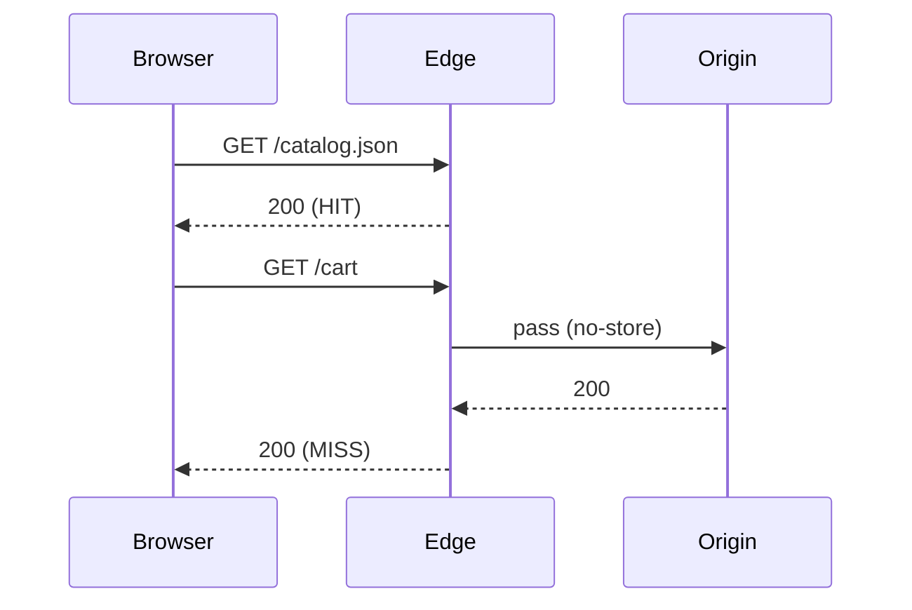

# Caching at the Edge

What we learned moving 2 TB/day of API traffic to a CDN

<div class="mt-8 op80">Sam Rivera · Platform team</div>

---
layout: two-cols-header
---

# Before and after

::left::

### Before

- Every request hits origin
- p95 latency **480 ms**
- 3 regions

::right::

### After

- 82 % served at the edge
- p95 latency **90 ms**
- 41 points of presence

::bottom::

<p class="text-sm op70">Numbers from the March 2026 rollout.</p>

---
layout: two-cols
layoutClass: gap-10
---

# Where the bytes go

Most of the traffic is product images and the catalogue JSON.

<ul class="legend">
<li><i style="background:#2a9d8f"></i>Product images: 64 %</li>
<li><i style="background:#e9a23b"></i>Catalogue JSON: 21 %</li>
<li><i style="background:#8d99ae"></i>Everything else: 15 %</li>
</ul>

<style>
.legend { list-style: none; padding: 0; }
.legend li { display: flex; align-items: center; gap: 0.6rem; margin: 0.4rem 0; }
.legend li::marker { content: ''; }
.legend i { width: 0.9rem; height: 0.9rem; border-radius: 2px; flex: none; }
</style>

::right::


---

# Cache keys

```ts {2-4|6}
export function cacheKey(req: Request): string {
  const url = new URL(req.url);
  url.searchParams.sort();
  url.searchParams.delete('utm_source');
  // Vary on language only, never on cookies
  return `${req.headers.get('accept-language') ?? 'en'}:${url}`;
}
```

---

# Header cheat sheet

| Header                   | Value                         | Effect                    |
| ------------------------ | ----------------------------- | ------------------------- |
| `Cache-Control`          | `public, max-age=300`         | edge and browser, 5 min   |
| `Surrogate-Control`      | `max-age=86400`               | edge only, 1 day          |
| `stale-while-revalidate` | `60`                          | serve old while refreshing |
| `Vary`                   | `Accept-Language`             | one copy per language     |

---

# Gotchas

> [!NOTE]
> Purges are eventually consistent: allow 5 s.

> [!WARNING]
> Never cache responses that set cookies.

> [!CAUTION]
> `Vary: *` disables caching completely.

---

# Hit ratio

With request rate $\lambda$ and TTL $T$, a key with Poisson arrivals hits with probability

$$
P(\text{hit}) = 1 - \frac{1}{1 + \lambda T}
$$

---

# Request flow



---

# What we would do again

<slide-ng-clicks>

- Start with the cache key, not the TTL
- Put `Surrogate-Control` on everything the edge may keep
- Watch the hit ratio per route, not per site
- Purge by tag, never by URL list

</slide-ng-clicks>

<!-- One minute here. The cache key slide is the one people ask about afterwards. -->

---
layout: end
---

# Thank you
